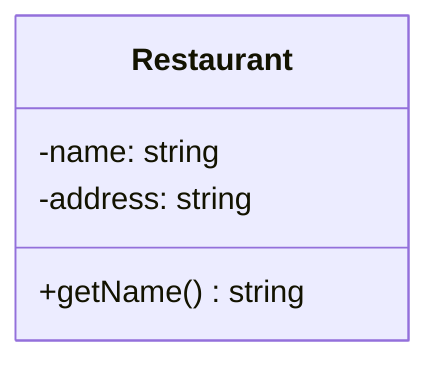
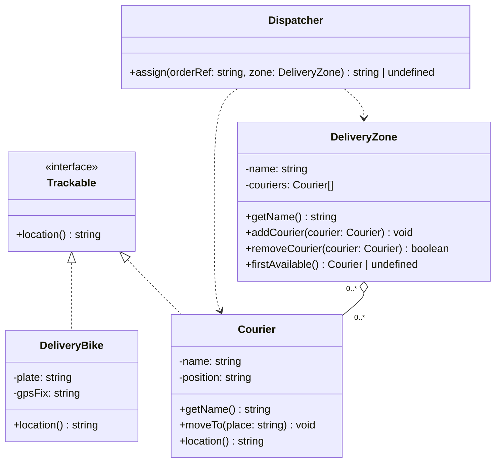

# Lab 5 — Answers (Parts A and B)

## Step 1



## Step 4

### Prediction 1

| Line | Will it be underlined in red? Which symbol in the diagrams of Steps 1 and 3 tells you? | The error message |
|---|---|---|
| (a) | Yes. The `<<abstract>>` stereotype on `MenuItem` tells us it cannot be instantiated directly. | `Cannot create an instance of an abstract class.` |
| (b) | Yes. The `#` symbol on `#category()` in `Dish` and `MenuItem` tells us the method is `protected` and cannot be called from outside the class hierarchy. | `Property 'category' is protected and only accessible within class 'Dish' and its subclasses.` |
| (c) | Yes. The `-` symbol on `-name: string` in `Customer` tells us the field is `private` and cannot be accessed outside `Customer`. | `Property 'name' is private and only accessible within class 'Customer'.` |

## Step 5

### Question 1

- **(a) Can a customer exist without ever having placed an order?**
  Yes — `0..*`, at the `Order` end (starts at `0`, meaning a customer can have zero orders).
- **(b) Can one order belong to two customers?**
  No — `1`, at the `Customer` end (each order is associated with exactly one customer).
- **(c) Can Bissap appear in many order lines?**
  Yes — `0..*`, at the `OrderLine` end (a menu item can be referred to by zero or many order lines).
- **(d) Can one order line refer to two menu items?**
  No — `1`, at the `MenuItem` end (each order line refers to exactly one menu item).

## Step 6

### Question 2

If an `Order` simply kept a list of `MenuItem`s without an `OrderLine` class, there would be no clean place to store the **quantity** ordered for each item (you would either have to duplicate the same `MenuItem` reference `n` times in the array, which makes computing subtotals and updating quantities awkward, or put an order-specific `quantity` field inside `MenuItem`, which breaks `MenuItem` when it is shared across multiple orders).

## Step 7

### Question 3

An `Order` exclusively owns its `OrderLine`s (they are created inside the `Order` and have no independent life outside that specific order, hence the filled composition diamond), whereas an `OrderLine` does not own its `MenuItem` (items like `thieb` or `bissap` exist on the menu independently and are shared across many orders).

## Step 8

### Question 4

- **(a)** No, the code is not wrong. In UML, an undecorated association line (`Customer "1" -- "0..*" Order`) shows a conceptual link between the two classes without forcing two-way navigability in code; storing `private customer: Customer` inside `Order` is sufficient to represent the relationship when we only need to navigate from an `Order` to its `Customer`.
- **(b)** Strictly speaking, right after `new Order(awa)` runs, the object has `0` lines, which temporarily violates `1..*`. Either:
  - **Change the diagram:** change the multiplicity at the `OrderLine` end from `1..*` to `0..*` so an empty order is valid, **or**
  - **Change the code:** require at least one initial item and quantity in `Order`'s constructor (`constructor(customer: Customer, firstItem: MenuItem, quantity: number)`) so an `Order` never exists with zero lines.

---

## Part B diagram



## Step 10

### Prediction 2

```text
Moussa
undefined Moussa Médina
```

### Question 5

The test lines that show composition (a filled diamond) is wrong are:

```typescript
const moussa = new Courier("Moussa", "Plateau");
...
plateau.addCourier(moussa);
...
plateau.removeCourier(moussa);
medina.addCourier(moussa);
```

`moussa` is created outside of any `DeliveryZone`, survives after being removed from `plateau`, and is then added to another zone (`medina`). In composition, parts are created and owned exclusively by one whole and cannot outlive it or be transferred to another whole.

## Step 11

### Question 6

`Dispatcher` would need to store `DeliveryZone` in a **field** (attribute), such as `private zone: DeliveryZone` or `private zones: DeliveryZone[]`, so that it keeps a lasting reference to the zone across method calls rather than only receiving it as a method parameter in `assign()`.

## Step 12

### Question 7

| Relationship | Line number in `dispatch.ts` | That line of code |
|---|---|---|
| `Courier` realizes `Trackable` | 5 | `class Courier implements Trackable {` |
| `DeliveryBike` realizes `Trackable` | 27 | `class DeliveryBike implements Trackable {` |
| `DeliveryZone` aggregates `Courier` | 43 | `  private couriers: Courier[] = [];` |
| `Dispatcher` depends on `DeliveryZone` | 70 | `  assign(orderRef: string, zone: DeliveryZone): string \| undefined {` |
| `Dispatcher` depends on `Courier` | 71 | `    const courier = zone.firstAvailable();` |
